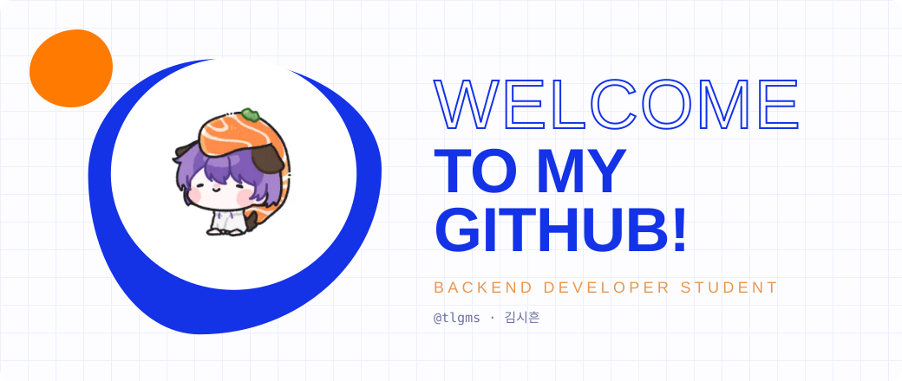
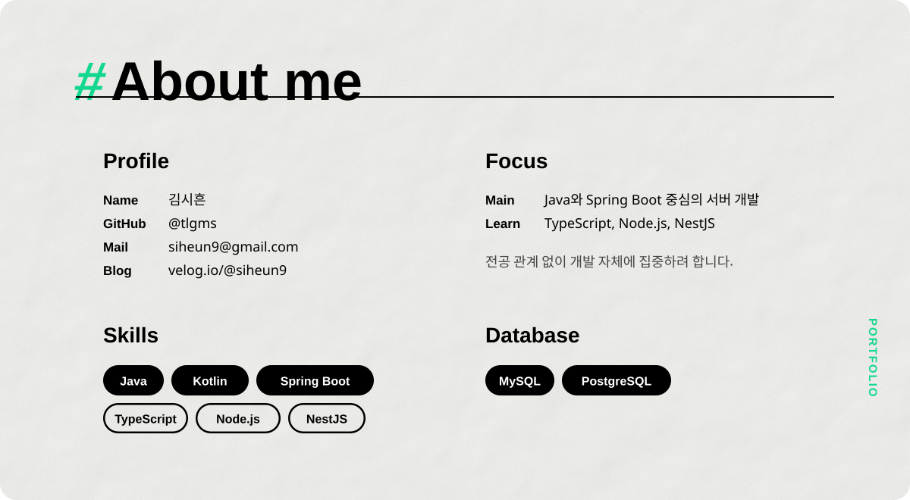
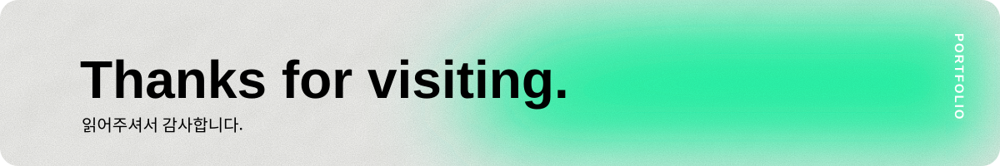

<!-- Header : I'm Backend Developer. -->

  

<!-- About me -->

  

 

<!-- Contact -->
<picture>
  <source media="(prefers-color-scheme: dark)" srcset="./assets/title-contact-dark.svg" />
  
</picture>

  
  
  
  

 

<!-- GitHub Stats -->
<picture>
  <source media="(prefers-color-scheme: dark)" srcset="./assets/title-stats-dark.svg" />
  
</picture>

  
  

 

<!-- Little Animal Zone -->
<picture>
  <source media="(prefers-color-scheme: dark)" srcset="./assets/title-animals-dark.svg" />
  
</picture>

  
  

 

<!-- Footer -->

  

