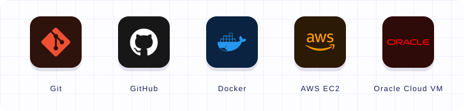

  

 

> **안**녕하세요! 백엔드 개발자를 목표로 공부 중인 학생입니다.
> **Java**와 **Spring Boot**를 중심으로 서버 개발을 배우고 있으며, Node.js, Express, NestJS, FastAPI도 함께 익히고 있습니다!

&nbsp; [velog.io/@siheun9](https://velog.io/@siheun9) 
&nbsp; [siheun9@gmail.com](mailto:siheun9@gmail.com) 
&nbsp; [github.com/tlgms](https://github.com/tlgms) 
&nbsp; [LinkedIn · 시흔 김](https://www.linkedin.com/in/%EC%8B%9C%ED%9D%94-%EA%B9%80-184a62393/)

 

## TECH STACK

| | |
|:--|:--|
| **LANG** |   |
| **SERVER** |      |
| **DATA** |   |

 

## TOOLBOX

 

## GITHUB STATS

  
  

 

## 🐾 LITTLE ANIMAL ZONE

A PLAYFUL SPACE SEPARATE FROM MY DEVELOPER PROFILE

  

  

